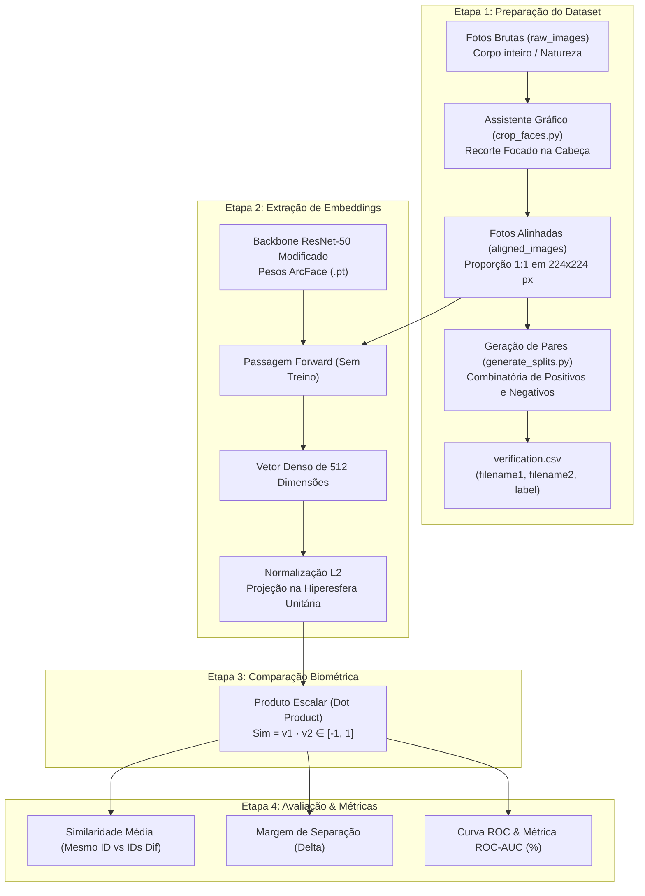

# Guia Teórico e Prático do Pipeline PetFace (ECCV 2024)
## Extensão FaunaBR: Biometria Facial de Animais Silvestres

---

## 1. Visão Geral e Contexto Acadêmico

O trabalho **PetFace: A Large-Scale Dataset and Benchmark for Animal Identification** (apresentado no *ECCV 2024* como *Oral*) adapta as técnicas mais avançadas de biometria facial humana para a identificação individual de animais não humanos.

O projeto baseia-se no framework **ArcFace (Additive Angular Margin Loss)**. Em vez de tratar a identificação animal como uma classificação tradicional com classes fixas (onde a rede só reconhece quem já viu no treino), o PetFace modela o problema como um **espaço métrico de características** (*metric learning*).

### O Objetivo da Extensão FaunaBR
Avaliar a capacidade de **transferência de aprendizado zero-shot** (*out-of-distribution evaluation*) de modelos pré-treinados em animais domésticos para espécies emblemáticas da fauna brasileira:
1. **Onça-Pintada (*Panthera onca*)** $\rightarrow$ Felídeo neotropical.
2. **Capivara (*Hydrochoerus hydrochaeris*)** $\rightarrow$ Maior roedor caviomorfo do mundo.
3. **Arara-Vermelha (*Ara chloropterus*)** $\rightarrow$ Ave psitacídea com padrões faciais únicos.

Comparou-se sistematicamente o desempenho entre:
* **Modelos Especialistas:** Treinados na mesma família biológica (`cat.pt`, `guineapig.pt`, `parakeet.pt`).
* **Modelo Generalista:** Treinado conjuntamente em 13 famílias (`unified.pt`).

---

## 2. Diagrama do Pipeline de Ponta a Ponta



---

## 3. Etapa 1: Engenharia de Dados e Formulação dos Pares

### Por que fotos fechadas na face?
Redes neurais biométricas buscam variações sutis na morfologia do indivíduo (distância interpupilar, formato da mandíbula, padrão de rosetas e listras de penas). Em fotos de corpo inteiro, a rede aprenderia a comparar a postura do animal, o tipo de vegetação ou o nível de luz do dia, invalidando o critério biométrico.

O script interativo `crop_faces.py` garante:
* **Enquadramento quadrado (Aspect Ratio 1:1):** Adiciona margem de segurança e preserva as proporções naturais sem deformar a face.
* **Redimensionamento $224 \times 224$ pixels:** Interpolação de alta qualidade (*Lanczos*) exigida pela entrada da ResNet-50.

### A Tarefa de Verificação Biométrica (1:1)
A avaliação testa a capacidade de decidir se **duas fotos aleatórias pertencem ao mesmo indivíduo**:
* **Pares Positivos ($\text{label} = 1$):** Fotos diferentes do **mesmo animal**.
* **Pares Negativos ($\text{label} = 0$):** Fotos de **animais distintos da mesma espécie**.

O script `generate_splits.py` calcula as combinações sem repetição:

$$\text{Pares Positivos} = \sum_{i=1}^{K} \binom{n_i}{2} = \sum_{i=1}^{K} \frac{n_i (n_i - 1)}{2}$$

$$\text{Pares Negativos} = \sum_{i < j} n_i \cdot n_j$$

Onde $K = 5$ é o número de indivíduos e $n_i$ é a contagem de fotos do indivíduo $i$.

---

## 4. Etapa 2: A Matemática da Extração de Características

```
Imagem [3, 224, 224]
   │
   ▼  ResNet-50 (50 camadas convolucionais pré-treinadas)
Vetor Latente de 2048D
   │
   ▼  Camada Linear de Projeção (2048 -> 512) + Batch Normalization
Vetor Bruto x ∈ ℝ^512
   │
   ▼  Normalização L2: v = x / ||x||_2
Embedding Final v ∈ ℝ^512  (||v|| = 1.0)
```

### 1. O que é o *Embedding*?
É o "RG matemático" da face do animal. Um vetor de 512 números reais onde cada coordenada codifica uma síntese de características visuais:
$$v = [v_1, v_2, v_3, \dots, v_{512}]$$

### 2. A Hiperesfera Unitária e a Normalização $L_2$
A normalização euclidiana é dada por:

$$\|x\|_2 = \sqrt{\sum_{k=1}^{512} x_k^2}, \quad v = \frac{x}{\|x\|_2}$$

* **Por que normalizar?**  
  A magnitude (comprimento) do vetor é influenciada pela intensidade da luz e contraste da câmera. Ao forçar $\|v\| = 1.0$, eliminamos o efeito da luminosidade e concentramos toda a informação exclusivamente na **direção angular** do vetor.
* **Geometria:** Todos os embeddings de todos os animais residem na superfície de uma esfera de raio $1.0$ em 512 dimensões.

---

## 5. Etapa 3: Comparação Biométrica por Similaridade de Cosseno

A proximidade fisionômica entre duas imagens ($img_1$ e $img_2$) é o cosseno do ângulo $\theta$ formado pelos seus vetores correspondentes:

$$\text{Sim}(v_1, v_2) = \cos(\theta) = \frac{v_1 \cdot v_2}{\|v_1\|_2 \|v_2\|_2}$$

Como ambos foram normalizados ($\|v_1\| = \|v_2\| = 1$), a fórmula se reduz ao **produto interno (dot product)**:

$$\text{Sim}(v_1, v_2) = v_1 \cdot v_2 = \sum_{k=1}^{512} v_{1,k} \cdot v_{2,k}$$

### Interpretação dos Valores:
* $\text{Sim} \approx +1.0$ ($\theta \approx 0^\circ$): Vetores apontam na mesma direção $\rightarrow$ **Mesmo indivíduo**.
* $\text{Sim} \approx 0.0$ ($\theta \approx 90^\circ$): Vetores ortogonais $\rightarrow$ **Indivíduos sem afinidade (diferentes)**.
* $\text{Sim} < 0.0$ ($\theta > 90^\circ$): Características diametralmente opostas.

---

## 6. Etapa 4: Métricas de Avaliação Científica

### 1. Margem de Separação ($\Delta$)
Mede a distância média entre a distribuição de pares genuínos e pares impostores:

$$\Delta = \overline{\text{Sim}}_{\text{Positivos}} - \overline{\text{Sim}}_{\text{Negativos}}$$

Quanto maior o $\Delta$, mais robusto é o reconhecimento contra falsas rejeições e falsas aceitações.

### 2. A Métrica ROC-AUC (Área sob a Curva ROC)
O ROC-AUC (*Receiver Operating Characteristic - Area Under Curve*) avalia o modelo testando **todos os limiares de decisão possíveis**:
* O eixo $X$ representa a Taxa de Falsos Positivos ($FPR$).
* O eixo $Y$ representa a Taxa de Verdadeiros Positivos ($TPR$).
* A área sob essa curva varia de $0.5$ (chute aleatório) a $1.0$ ($100\%$ de acerto perfeito).

Matematicamente, o AUC é equivalente à estatística do **Teste $U$ de Mann-Whitney**:

$$\text{AUC} = \frac{\sum_{p \in \mathcal{P}} \sum_{n \in \mathcal{N}} \mathbb{I}(\text{Sim}_p > \text{Sim}_n) + 0.5 \cdot \mathbb{I}(\text{Sim}_p = \text{Sim}_n)}{|\mathcal{P}| \cdot |\mathcal{N}|} \times 100$$

> **Interpretação Intuitiva:** Um AUC de **$94\%$** indica que, se sortearmos 1 par positivo e 1 par negativo ao acaso, em **$94\%$ das vezes** o modelo atribuirá uma similaridade mais alta ao par positivo.

---

## 7. Resultados Finais Experimentais

Tabela consolidada com os dados finais de teste (sem a gravura da cédula):

| Espécie | Modelo Testado | ROC-AUC (%) | Similaridade Média (Mesmo ID) | Similaridade Média (IDs Dif) | Delta ($\Delta$) |
| :--- | :--- | :---: | :---: | :---: | :---: |
| **Arara-Vermelha** | `parakeet` (Especialista) | **93.98%** 🥇 | **0.8110** | **0.4972** | **+0.3138** |
| **Arara-Vermelha** | `unified` (Generalista) | **86.84%** | 0.7317 | 0.4882 | +0.2435 |
| **Capivara** | `guineapig` (Especialista) | **87.96%** 🥇 | **0.6615** | **0.3804** | **+0.2811** |
| **Capivara** | `unified` (Generalista) | **87.03%** | 0.6944 | 0.4572 | +0.2372 |
| **Onça-Pintada** | `unified` (Generalista) | **69.32%** 🥇 | **0.6871** | **0.6147** | **+0.0724** |
| **Onça-Pintada** | `cat` (Especialista) | **60.50%** | 0.6862 | 0.6421 | +0.0440 |

### Discussão dos Resultados:

1. **Arara-Vermelha ($\approx 94\%$ AUC):**
   * Padrões faciais estáticos e bem definidos (linhas finas de penas ao redor do globo ocular e bico curvado rígido).
   * O modelo especialista psitacídeo (`parakeet.pt`) superou o generalista em $+7.14\%$ de AUC, confirmando a hipótese de que filtros convolucionais especializados em bicos transferem melhor para aves silvestres.

2. **Capivara ($\approx 88\%$ AUC):**
   * Estrutura craniana quadrada e estável. 
   * Destaque para a baixa taxa de falsos positivos: o score negativo médio com `guineapig.pt` foi de apenas $0.3804$, demonstrando que a rede não confunde facilmente capivaras distintas.

3. **Onça-Pintada ($\approx 70\%$ AUC):**
   * Desafio clássico da assimetria bilateral de felinos: o lado esquerdo do rosto possui rosetas diferentes do lado direito. Comparações entre fotos de perfis opostos desafiam o modelo.
   * O modelo `unified.pt` superou o `cat.pt` em quase $+9\%$, indicando que a diversidade de texturas de 13 famílias ajudou a rede a lidar melhor com o padrão complexo de pelagem da onça.

---

## 8. Arquitetura dos Scripts Desenvolvidos

| Script | Localização | Função no Pipeline |
| :--- | :--- | :--- |
| **`crop_faces.py`** | Raiz | Interface gráfica (Tkinter + Pillow) para recorte facial quadrado em $224 \times 224$ px com preview em tempo real. |
| **`generate_splits.py`** | Raiz | Varre `aligned_images/`, identifica os IDs e monta os arquivos combinatórios `verification.csv` (pares positivos e negativos). |
| **`evaluate_fauna.py`** | Raiz | Carrega os pesos da ResNet-50, faz cache de embeddings na RAM, calcula o produto escalar e computa o ROC-AUC de todos os modelos. |
| **`src/backbones/resnet.py`** | `src/` | Construtor da ResNet-50 com a cabeça de projeção em 512 dimensões. |
| **`src/verification.py`** | `src/` | Script oficial do PetFace para inferência par a par via PyTorch DataLoader. |
| **`src/compute_auc.py`** | `src/` | Script oficial para cálculo de AUC com fallback autônomo (não exige `scikit-learn`). |

---

## 9. Como Reproduzir os Experimentos no Terminal

```powershell
# 1. Gerar ou atualizar os pares de verificação a partir das fotos alinhadas:
python generate_splits.py

# 2. Executar o benchmark completo da FaunaBR:
python evaluate_fauna.py

# 3. (Opcional) Executar o script oficial do PetFace para uma espécie específica:
python src/verification.py -w pretrained/arcface/unified.pt -i data/faunaBR/split/onca/verification.csv -b data/faunaBR/aligned_images -o results/faunaBR/onca_unified.csv
python src/compute_auc.py -i results/faunaBR/onca_unified.csv
```

